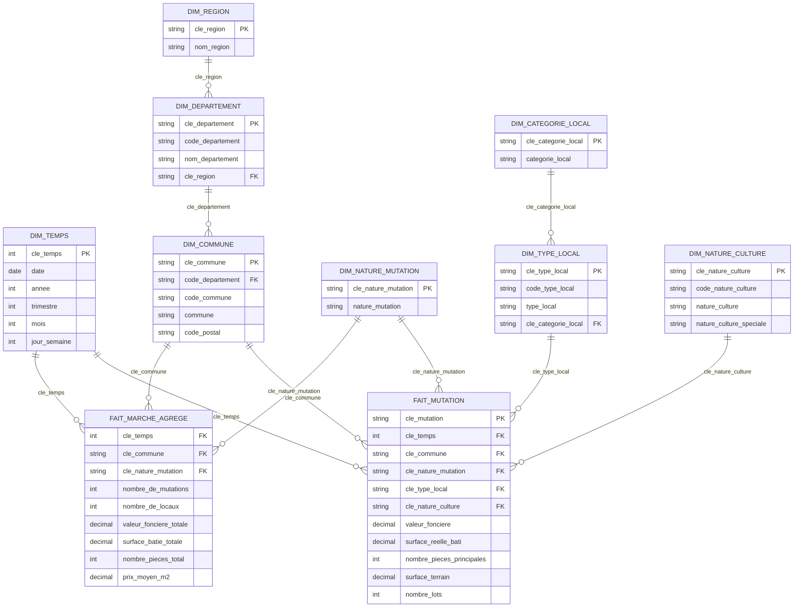

# Datamart DVF 2024-2025 - modèle en flocon

Datamart construit **intégralement en Power Query** dans Power BI Desktop, à partir
des fichiers source bruts `ValeursFoncieres-2024.txt` et `ValeursFoncieres-2025.txt`
(920 Mo au total, 43 colonnes, séparateur `|`).

> `DVF_Brut` liste les fichiers `ValeursFoncieres-*.txt` du dossier pour les années
> retenues. Le jeu DVF complet couvre 2021 à 2025 ; les années 2021 à 2023 ont été
> écartées pour rester dans les limites de mémoire du poste de travail (5 ans
> représentent ≈ 20 M de lignes ; 2 ans en représentent 7,2 M). Pour les
> réintégrer, il suffit d'ajouter les années à la liste `Annees` de `DVF_Brut`
> puis d'actualiser.

> Le script `convert_dvf_to_datamart.py` a servi de brouillon pour valider le modèle
> (il produisait des CSV intermédiaires). Il n'est **plus utilisé** : toutes les
> transformations sont désormais dans Power Query.

---

## 1. Schéma en flocon



**11 relations**, toutes en 1 vers \*, filtre à sens unique.

Deux hiérarchies en flocon permettent de descendre du territoire au bien :

- **région → département → commune** (`dim_region` → `dim_departement` → `dim_commune`)
- **catégorie de local → type de local** (`dim_categorie_local` → `dim_type_local`)

---

## 2. Requêtes Power Query

Tout part d'**une seule requête partagée** qui lit les fichiers source. Les autres
requêtes la référencent par son nom : les fichiers ne sont donc lus **qu'une fois
par actualisation**.

| Requête | Rôle | Lignes |
|---|---|---:|
| `DVF_Brut` | lit les fichiers des `Annees` retenues dans le dossier : 20 colonnes conservées sur 43, renommage, conversion des types (locale `fr-FR`), reconstruction des zéros de tête | 7 214 760 |
| `q_fait_mutation` | table de faits détaillée : construction des 5 clés étrangères + `cle_mutation` | 7 214 760 |
| `q_fait_agrege` | table de faits agrégée (datamart) | 1 614 973 |
| `q_ref_departement` | référentiel des 101 départements (nom + région), table écrite en M | 101 |
| `q_ref_region` | référentiel des 18 régions, table écrite en M | 18 |
| `q_dim_temps` | calendrier (année, trimestre, mois, jour de semaine) | 724 |
| `q_dim_commune` | communes | 33 218 |
| `q_dim_departement` | départements présents dans les données, enrichis (nom, région) | 97 |
| `q_dim_region` | régions présentes dans les données | 17 |
| `q_dim_nature_mutation` | Vente, Échange, Adjudication, Expropriation… | 6 |
| `q_dim_type_local` | Maison, Appartement, Dépendance, Local comm., non renseigné | 5 |
| `q_dim_categorie_local` | catégories de local (table de référence écrite en M) | 5 |
| `q_dim_nature_culture` | nature de culture / terrain | 246 |

> `q_ref_departement` et `q_ref_region` sont des **tables de référence** : elles ne
> sont pas chargées dans le modèle, elles servent uniquement à enrichir
> `q_dim_departement` et `q_dim_region`.

Ces requêtes alimentent les **10 tables** du modèle :

| Table | Requête source | Lignes |
|---|---|---:|
| `fait_mutation` (datawarehouse) | `q_fait_mutation` | 7 214 760 |
| `fait_marche_agrege` (datamart) | `q_fait_agrege` | 1 614 973 |
| `dim_temps` | `q_dim_temps` | 724 |
| `dim_commune` | `q_dim_commune` | 33 218 |
| `dim_departement` | `q_dim_departement` | 97 |
| `dim_region` | `q_dim_region` | 17 |
| `dim_nature_mutation` | `q_dim_nature_mutation` | 6 |
| `dim_type_local` | `q_dim_type_local` | 5 |
| `dim_categorie_local` | `q_dim_categorie_local` | 5 |
| `dim_nature_culture` | `q_dim_nature_culture` | 246 |

> Les colonnes source `Identifiant de document` et `Reference document` sont
> **vides sur 100 %** des lignes : elles ne sont pas chargées.
>
> Les CSV du dossier `datamart/` ne sont plus utilisés par Power BI. Ils restent
> comme trace du brouillon Python.

---

## 3. ⚠️ Piège critique : la valeur foncière est répétée

Les fichiers source **ne contiennent aucun identifiant de document**
(`Identifiant de document` et `Reference document` sont vides à 100 %).

Résultat : une mutation (vente) est éclatée en **plusieurs lignes**, une par bien,
et la `valeur_fonciere` est **répétée sur chacune**. En moyenne :

> 7 214 760 lignes ÷ 2 558 598 mutations = **2,82 lignes par mutation**

Conséquence sur les mesures :

| Calcul | Résultat | Verdict |
|---|---:|---|
| `SUM(valeur_fonciere)` sur toutes les lignes | 6 075 010 413 359 € | ❌ **~10× trop élevé** |
| `SUM(valeur_fonciere)` une fois par `cle_mutation` | 604 914 936 592 € | ✅ correct |

C'est la raison d'être de la table de faits **agrégée** : elle stocke directement
la valeur correcte, une seule fois par mutation.

**La colonne `cle_mutation` regroupe les lignes contiguës** partageant
`date + commune + nature + valeur`. C'est la seule façon d'obtenir un nombre de
ventes et un montant total justes.

### Mesures DAX correctes à utiliser

```dax
Nb mutations :=
DISTINCTCOUNT ( fait_mutation[cle_mutation] )

Valeur fonciere totale :=
SUMX (
    VALUES ( fait_mutation[cle_mutation] ),
    CALCULATE ( AVERAGE ( fait_mutation[valeur_fonciere] ) )
)

Valeur fonciere moyenne par mutation :=
DIVIDE ( [Valeur fonciere totale], [Nb mutations] )

Prix moyen au m2 :=
DIVIDE (
    [Valeur fonciere totale],
    SUM ( fait_mutation[surface_reelle_bati] )
)
```

> `AVERAGE` (et non `MAX`) est utilisé dans le modèle : si la valeur est absente
> sur une des lignes d'une mutation, la moyenne la retrouve au lieu de renvoyer 0.

Les mesures déposées dans le modèle :

| Mesure | Table | Formule |
|---|---|---|
| `Nombre de mutations` | `fait_mutation` | `DISTINCTCOUNT(cle_mutation)` |
| `Valeur fonciere totale` | `fait_mutation` | `SUMX(VALUES(cle_mutation), CALCULATE(AVERAGE(valeur_fonciere)))` |
| `Valeur fonciere moyenne` | `fait_mutation` | `DIVIDE([Valeur fonciere totale], [Nombre de mutations])` |
| `Surface batie totale` | `fait_mutation` | `SUM(surface_reelle_bati)` |
| `Surface terrain totale` | `fait_mutation` | `SUM(surface_terrain)` |
| `Prix moyen m2` | `fait_mutation` | `DIVIDE([Valeur fonciere totale], [Surface batie totale])` |
| `Nombre de locaux` | `fait_mutation` | `COUNTROWS(fait_mutation)` |
| `Nb mutations agrege` | `fait_marche_agrege` | `SUM(nombre_de_mutations)` |
| `Nb locaux agrege` | `fait_marche_agrege` | `SUM(nombre_de_locaux)` |
| `Valeur agregee` | `fait_marche_agrege` | `SUM(valeur_fonciere_totale)` |
| `Valeur moyenne agregee` | `fait_marche_agrege` | `DIVIDE([Valeur agregee], [Nb mutations agrege])` |
| `Surface agregee` | `fait_marche_agrege` | `SUM(surface_batie_totale)` |
| `Prix moyen m2 agrege` | `fait_marche_agrege` | `DIVIDE([Valeur agregee], [Surface agregee])` |

Contrôle de cohérence entre les deux tables de faits :

| Indicateur | Table détaillée | Table agrégée |
|---|---:|---:|
| Nombre de mutations | 2 558 598 | 2 558 598 |
| Valeur foncière totale | 604 914 936 592 € | 604 914 936 592 € |
| Prix moyen au m² | 2 172,46 € | 2 172,46 € |

---

## 4. Transformations réalisées (pour le rendu)

Six transformations sont mises en œuvre (**3 étaient demandées**),
et **toutes sont faites dans Power Query**.

| # | Transformation | Où, dans Power Query |
|---|---|---|
| 1 | **Séparation d'une table en plusieurs** | `DVF_Brut` (43 colonnes) alimente 1 fait détaillée + 9 dimensions via `Table.SelectColumns` |
| 2 | **Colonnes calculées** | `cle_temps`, `annee`, `trimestre`, `mois`, `jour_semaine` (`q_dim_temps`) ; `cle_commune` (`q_dim_commune`) ; `cle_nature_culture` (`q_dim_nature_culture`) ; `cle_categorie_local` (`q_dim_type_local`) ; `cle_mutation` (`q_fait_mutation`) ; `prix_moyen_m2` (`q_fait_agrege`) |
| 3 | **Modification de clé** | reconstruction des codes INSEE et postaux dont les **zéros de tête avaient été perdus** dans le source (`1550` → `01550`, `158` → `00158`) via `Text.PadStart` ; création des clés de substitution `cle_temps`, `cle_commune`, `cle_nature_culture`, `cle_mutation`, `cle_departement`, `cle_type_local` |
| 4 | **Dédoublonnage** | `Table.Distinct` sur chaque dimension ; `Table.Distinct` sur la clé pour garantir l'unicité côté « 1 » (`cle_commune`, `cle_nature_culture`) ; `Table.Distinct` sur `cle_mutation` dans `q_fait_agrege` |
| 5 | **Agrégation** | `q_fait_agrege` : `Table.Group` par `cle_temps + cle_commune + cle_nature_mutation` pour calculer le nombre de mutations, la valeur totale, la surface bâtie et le prix moyen au m² |
| 6 | **Fusion de référentiels (merge)** | `q_dim_departement` fusionne les codes département présents dans les données avec `q_ref_departement` (nom du département + région) ; `q_dim_region` fusionne `q_ref_region` pour obtenir le libellé des régions |

---

## 5. Architecture : datawarehouse + datamart

Le cahier des charges impose **une table de faits détaillée et une table de faits
agrégée**. Le modèle en contient deux :

### `fait_mutation` : table de faits détaillée (datawarehouse)

- **Grain** : 1 ligne = 1 bien (local) dans 1 mutation.
- **Volume** : 7 214 760 lignes.
- **Clés étrangères** : `cle_temps`, `cle_commune`, `cle_nature_mutation`,
  `cle_type_local`, `cle_nature_culture` (5 dimensions).
- **Usage** : analyses fines, croisement par type de bien, pièces, surfaces.

### `fait_marche_agrege` : table de faits agrégée (datamart)

- **Grain** : 1 ligne = 1 commune × 1 jour × 1 nature de mutation.
- **Volume** : 1 614 973 lignes (4,5× plus compacte).
- **Clés étrangères** : `cle_temps`, `cle_commune`, `cle_nature_mutation`.
- **Mesures stockées** : `nombre_de_mutations`, `nombre_de_locaux`,
  `valeur_fonciere_totale`, `surface_batie_totale`, `nombre_pieces_total`,
  `prix_moyen_m2`.
- **Usage** : tableaux de bord synthétiques, historiques par territoire.

> Le grain de l'agrégat a été choisi sur des attributs **de la mutation**
> (`commune`, `date`, `nature`) et non du bien : c'est le seul grain qui permet
> de sommer la valeur foncière sans la compter plusieurs fois.

---

## 6. Cas métier et besoin analytique

### Cas métier

Suivre le **marché immobilier français** à partir des mutations foncières
enregistrées en 2024 et 2025 (DVF, source `data.gouv.fr`) : où se vend quoi, à quel
prix, et comment le prix au m² évolue d'une année sur l'autre.

### Besoin analytique

> Pour un **territoire (région / département / commune)** et une **période**
> (année, trimestre, mois), connaître le **nombre de mutations**, le **volume total**
> en euros et le **prix moyen au m²**, et pouvoir ventiler par **type de bien** et
> **nature de mutation**.

### Tableaux croisés (matrices) réalisés

Quatre pages dans le rapport du projet `Projet_Solaris.pbip` : **une page par
année et par table de faits**. Chaque page porte un **filtre de page** sur
`dim_temps[annee]`, donc toutes les analyses y sont déjà restreintes à son année.

| Page | Table de faits | Lignes | Colonnes | Valeurs |
|---|---|---|---|---|
| **Marché immobilier 2025** | détaillée (datawarehouse) | `dim_commune[commune]` | `dim_temps[annee]` | `[Nombre de mutations]`, `[Valeur fonciere totale]`, `[Prix moyen m2]` |
| **Marché par région et département 2025** | agrégée (datamart) | `dim_region[nom_region]` | `dim_temps[annee]` | `[Nb mutations agrege]`, `[Valeur agregee]`, `[Prix moyen m2 agrege]` |
| **Marché immobilier 2024** | détaillée (datawarehouse) | `dim_commune[commune]` | `dim_temps[annee]` | idem 2025 |
| **Marché par région et département 2024** | agrégée (datamart) | `dim_region[nom_region]` | `dim_temps[annee]` | idem 2025 |

Les deux pages « par région et département » contiennent un **second visuel** qui
descend au département (`dim_departement[nom_departement]`), avec les mêmes mesures.
La hiérarchie **région → département → commune** est exploitable directement dans un
visuel : filtrer une région filtre ses départements et ses communes.

Résultats de contrôle obtenus sur le modèle (2024-2025) :

| Région | Mutations | Prix moyen au m² |
|---|---:|---:|
| Île-de-France | 341 543 | 4 641 € |
| Auvergne-Rhône-Alpes | 347 443 | 2 203 € |
| Provence-Alpes-Côte d'Azur | 235 774 | 3 365 € |
| Occitanie | 287 550 | 1 938 € |
| Nouvelle-Aquitaine | 290 617 | 1 484 € |
| Corse | 15 487 | 3 465 € |
| Guadeloupe | 6 747 | 4 227 € |
| Grand Est | 111 370 | 1 282 € |

| Département | Mutations | Prix moyen au m² |
|---|---:|---:|
| Paris (75) | 76 180 | 10 253 € |
| Hauts-de-Seine (92) | 48 202 | 6 364 € |
| Alpes-Maritimes (06) | 64 628 | 4 528 € |
| Bouches-du-Rhône (13) | 70 429 | 3 321 € |
| Var (83) | 58 126 | 3 312 € |
| Rhône (69) | 61 698 | 2 628 € |

Évolution annuelle (vue globale) :

| Année | Mutations | Valeur foncière totale | Prix moyen au m² |
|---|---:|---:|---:|
| 2024 | 1 237 625 | 285 013 446 757 € | 2 156,13 € |
| 2025 | 1 320 973 | 319 901 489 835 € | 2 187,23 € |

---

## 7. Reproduire / actualiser

Le datamart n'est plus produit par un script : il est **construit par Power Query
dans le projet `Projet_Solaris.pbip`**.

1. Ouvrir `Projet_Solaris.pbip` dans Power BI Desktop.
2. **Accueil → Actualiser** : Power Query relit les fichiers `ValeursFoncieres-*.txt`
   et reconstruit les 10 tables. Inutile tant que la source n'a pas changé : les
   données sont déjà dans le cache du projet.
3. Les fichiers source doivent rester à cet emplacement :
   `C:\Users\Lenovo\Desktop\PowerBi\Projet_Solaris\ValeursFoncieres-AAAA.txt`.
   Le chemin du dossier est codé dans la requête `DVF_Brut`.

> Un rafraîchissement complet relit ≈ 920 Mo (2024 + 2025) et reconstruit les
> agrégats : comptez une dizaine de minutes.
>
> Pour changer les années couvertes, modifier la liste `Annees` de `DVF_Brut`
> (voir §1) puis actualiser. Attention à la mémoire du poste : 5 années
> représentent ≈ 20 M de lignes.

### Ancien brouillon Python (conservé, non utilisé)

```powershell
python -m venv .venv
.venv\Scripts\python.exe convert_dvf_to_datamart.py
.venv\Scripts\python.exe convert_dvf_to_datamart.py --limit 200000
```
